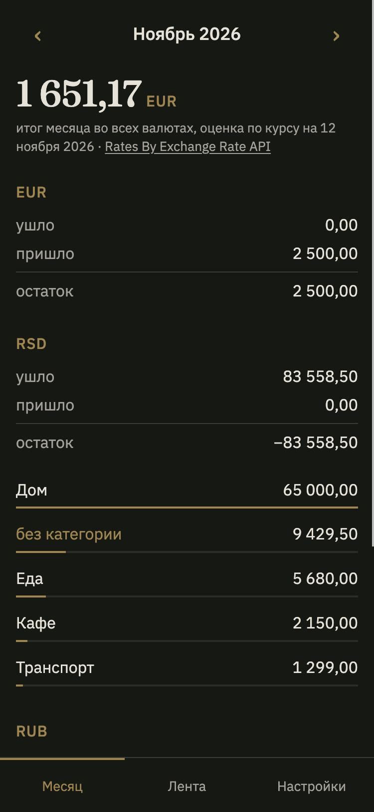
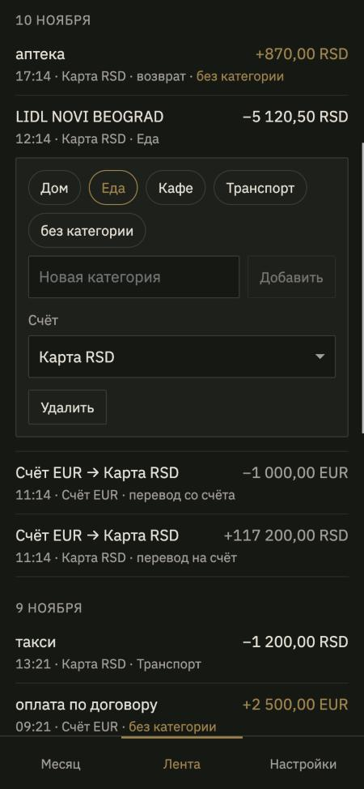
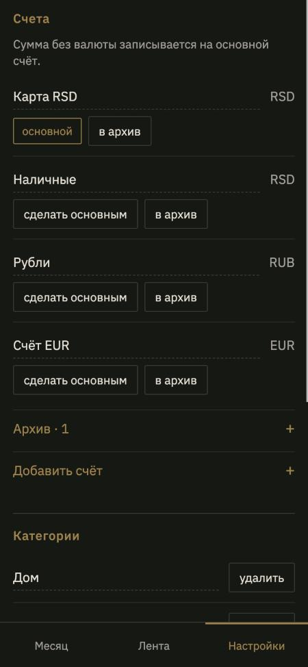

<p align="center">
  
</p>

<p align="center">
  <a href="https://github.com/4wl2d/mon22r/actions/workflows/ci.yml"></a>
  <a href="https://github.com/4wl2d/mon22r/security/code-scanning"></a>
  
  
</p>

# mon22r

A personal-finance ledger for one person, in Telegram. Write what you spent in the chat, look at the month in a Mini App, keep expected income in view. You run the server and own its SQLite file.

**[Set up](docs/SETUP.md)** · **[Operate](docs/OPERATIONS.md)** · **[Architecture](docs/ARCHITECTURE.md)**

## In the chat

```text
кофе 350                                  expense on the default account
кофе 350 #еда                             with a category; the tag creates it if needed
кофе 4.50 gbp · обед €12 · такси 1200р    another currency
+зп 180000                                income
возврат кроссовки 5000                    refund, lowers spending
вчера такси 1200 · 5.11 такси 1200        another day
перевод 5000 на наличные                  between accounts
перевод 500 eur с евро на карта 58600     conversion: sent amount, then what arrived
план зп 180000 5                          expect it on the 5th, every month
/month    /undo    /help
```

- The reply shows what was saved, with buttons to undo it, pick a category, or move it to another account of the same currency. The message redraws in place.
- An amount without a currency goes to the **default account**, in that account's currency. Without a default it is read in the home currency. For a named currency the bot reuses the account your last hand-entered line of that currency went to.
- A category chosen once is remembered for the same note, in the chat and for imported statement lines.
- Send a CSV statement as a file. Unknown formats ask once for the column names; then you get a preview of new, duplicate, and skipped lines and confirm the import.
- `/undo` removes the last line you typed, never an imported one, and says what it removed.

## In the Mini App

- **Месяц.** One number for the month in your home currency, labeled as an estimate at the day's rate, then income, spending, and categories per currency. Tapping a category opens its entries. Expected income for the month is listed below with its status.
- **Лента.** Entries by day with search and filters. Tap an entry to set its category in one tap, move it, or delete it. With a search or filter active, one action categorizes everything found.
- **Настройки.** Accounts and the default account, categories, home currency, and time zone.

Screens load from a small cache and refresh in the background, so changing tabs or months does not blank the page.

<p align="center">
  
  
  
</p>
<p align="center"><sub>Screens from <code>pnpm preview</code>, with made-up data.</sub></p>

## What keeps it reliable

- Amounts are integer minor units; currencies are never added together; a transfer is two linked rows outside income and spending.
- A Telegram message is applied once, even if Telegram delivers it again after a restart.
- The process stops cleanly on a release, confirms what it handled, and restarts itself if polling stalls.
- A verified backup is written daily and kept for 14 days, and a copy is sent to your own chat weekly when the ledger changed. Every release takes one first.
- Releases are built, tested, booted, and health-checked by the pipeline, and rolled back automatically if the new version does not come up healthy.

## Quick start

Requires **Node.js 22 or 24** and **pnpm 10.34.9**.

```sh
corepack enable
pnpm install --frozen-lockfile

pnpm verify     # format, lint, typecheck, tests, builds
pnpm preview    # the Mini App on a throwaway ledger, no Telegram needed
```

To run your own instance, follow [setup](docs/SETUP.md). Day-to-day operation, backups, restore, and troubleshooting are in [operations](docs/OPERATIONS.md).

## Layout

```text
apps/server        grammY bot, Hono API, backups, scheduled jobs
apps/miniapp       React 19 + Vite + Telegram Mini Apps SDK
packages/domain    Money, transactions, months, plans, FX estimates
packages/db        Drizzle + better-sqlite3, versioned migrations, backups
packages/importers CSV parsing, mapping, preview, duplicate handling
deploy             Production stack, release scripts, pipeline helpers
```

## Boundaries

- Built for one owner. The allowlist admits the Telegram IDs you configure and nobody else.
- Chat grammar and interface are Russian.
- Entry is by hand or by CSV. There is no bank connection.
- Home-currency totals are estimates from a daily reference rate ([Rates By Exchange Rate API](https://www.exchangerate-api.com)); stored amounts are never converted.
- The reminder flag on a plan is stored but nothing sends reminders.
- Telegram carries your messages and files, and the weekly backup copy. Self-hosting covers the server and the database, not Telegram.
- Access control and signed Mini App launch data are implemented and tested; that is not a security audit.

No open-source license has been selected. All rights reserved.
